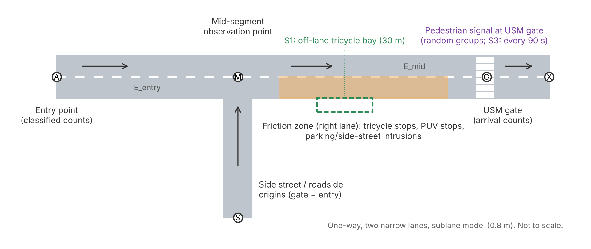

# Bai Matabay Plang Avenue corridor microsimulation

Field data, a calibrated SUMO microsimulation, and a web dashboard for a study of friction-driven congestion on Bai Matabay Plang Avenue, the one-way access road between the Davao–Cotabato National Highway and the University of Southern Mindanao (USM) main gate in Kabacan, Cotabato, Philippines.

## Contents

| File | Purpose |
|---|---|
| `field_data.json` | Manual counts per 15-minute interval for the morning, midday, and evening peaks: classified entry volumes, gate arrivals, pedestrians near the gate, tricycle stops, jeepney/SUV stops, parking and side-street intrusions, tricycle dwell times, and observed flow status |
| `config.json` | Corridor geometry, friction and pedestrian parameters, simulation settings, and scenario definitions |
| `run_bmp.py` | Builds the SUMO network and demand from the field data, runs every scenario and seed, validates the baseline with the GEH statistic, and writes the results |
| `RUN_SIMULATION.bat` | One-click launcher for Windows (writes `run_log.txt`) |
| `index.html` | Interactive dashboard: field data, correlations, and SUMO scenario results |
| `tools/fill_paper.py` | Fills the simulation values in the manuscript from `results/results.json` |

## Running the model

Requirements: [Eclipse SUMO](https://eclipse.dev/sumo/) 1.15 or later (with `SUMO_HOME` set), Python 3.9+, and optionally `matplotlib` for the figures.

1. Set the measured segment lengths, lane count, and lane width in `config.json`.
2. Run `python run_bmp.py` (or double-click `RUN_SIMULATION.bat` on Windows).
3. Results are written to `results/`:
   - `validation.csv`: observed versus simulated 15-minute gate counts with GEH
   - `summary.csv`: travel time, time loss, waiting time, mid-segment speed, maximum queue, and CO₂ per scenario and peak (mean ± SD across seeds)
   - `results.json`: everything above, for the dashboard
   - `fig_validation.png`, `fig_time_loss.png`

To watch one case, run `python run_bmp.py --gui S0_baseline morning`. To generate the SUMO input files without running them, run `python run_bmp.py --dry-run`.

## How the field data drive the model

| Field observation | Model element |
|---|---|
| Classified entry counts per 15 min | Vehicles inserted on the entry link by class and interval |
| Gate count minus entry count | Additional inflow from the side street and roadside origins |
| Tricycle stoppages and mean dwell time | Tricycles stopping on the right lane of the friction zone, dwell ~ Normal(mean, 0.3 × mean) |
| Jeepney/SUV stops | 20-s on-lane stops (assumed) |
| Parking and side-street intrusions | Roadside vehicles occupying the right lane for 60 s (assumed) before merging |
| Pedestrians near the USM gate | Groups of five pedestrians blocking traffic for 7 s each (assumed) |

Mixed traffic uses SUMO's sublane model (lateral resolution 0.8 m), so motorcycles can filter past tricycles. Each run has a 15-minute warm-up before the 60-minute peak; results cover only vehicles departing during the peak hour. Durations not measured in the field are stated assumptions in `config.json`.

## Scenarios

| ID | Scenario |
|---|---|
| S0 | Existing conditions |
| S1 | Off-lane tricycle loading bay (30 m, 8 spaces) |
| S2 | No-parking enforcement in the mid-segment |
| S3 | Controlled pedestrian crossing at the USM gate (12-s release every 90 s) |
| S4 | S1 + S2 + S3 combined |

Total vehicular demand is identical in every scenario.

## Dashboard

`index.html` runs in any browser with no installation. With GitHub Pages enabled (Settings → Pages → Deploy from branch → `main` / root), it is served at
`https://monteropeterdominic-arch.github.io/bmp-corridor-microsimulation/`.
Open the **SUMO scenarios** tab and load `results/results.json` to display the simulation output.

## Authors

Peter Dominic C. Montero, Keith Ternura, Lesly A. Bocado, John Paul Esparagoza, Samrah Angeles, Rachelle Anne Barbecho, Jeko Jann G. Heyres, Carl Jay G. Ostaga, Jovan A. Prudente, Alexa Mae Serjas, Khent Brylle L. Yson (BSCE, Highway & Railway Engineering), and Ebrahim A. Omar (Faculty of Civil Engineering), University of Southern Mindanao, Kabacan, Cotabato.

## License

Code is released under the MIT License (see `LICENSE`). The field data in `field_data.json` are released under CC BY 4.0. Please cite the accompanying paper (see `CITATION.cff`) when using them.
